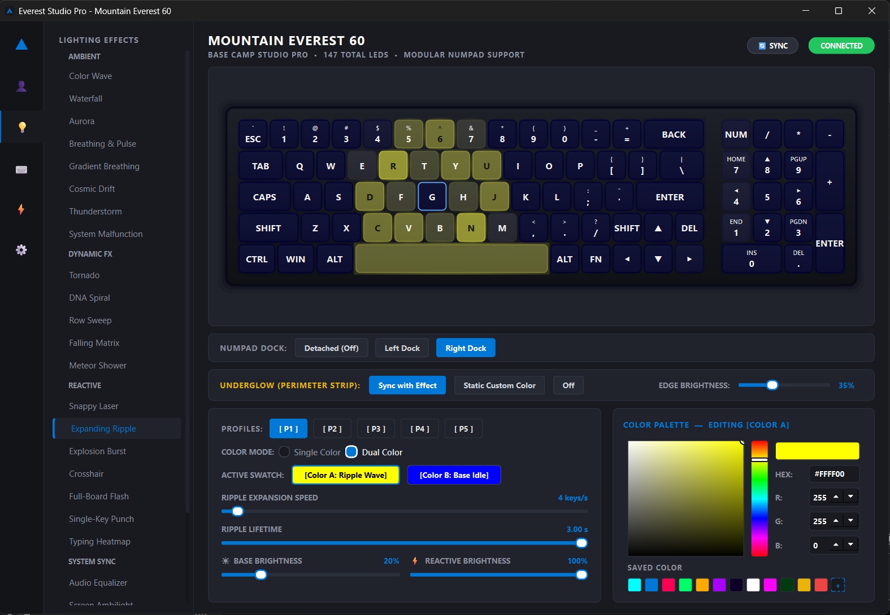

# Everest Studio Pro

[](https://github.com/hamza23200/everest-studio-pro/releases/latest)
[-0078D7?style=for-the-badge)](https://github.com/hamza23200/everest-studio-pro/releases/latest)
[](https://www.python.org/)
[](LICENSE)

A fast, lightweight, free replacement for Mountain Base Camp built specifically for the **Mountain Everest 60** mechanical keyboard (including the modular numpad).



### Why Switch from Base Camp?
* **25 Custom RGB Effects** — including a live music visualizer, screen color sync, lightning storms, typing heatmap, and snappy reactive lasers.
* **Ultra-Lightweight** — runs quietly in your system tray with minimal CPU/RAM usage.
* **No Accounts or Bloat** — zero logins, zero cloud sync, zero background telemetry. Everything saves locally.
* **Full Control** — independent brightness sliders for keys vs. desk underglow, 5 quick-switch presets (`P1`–`P5`) per effect, and full Left / Right / Detached numpad support.

---

## Easy Install (Windows 10 & 11 — No Coding Needed)

You can get running in under 2 minutes:

### 1. Close Mountain Base Camp
Right-click the **Base Camp** icon in your taskbar (click the little `^` arrow near the clock) and select **Exit**.
> *Tip: Open **Task Manager → Startup Apps** and disable Mountain Base Camp so it doesn't fight Everest Studio Pro for control of your keyboard.*

### 2. Download Everest Studio Pro
1. Click **Releases** on the right side of this page (or [click here](https://github.com/hamza23200/everest-studio-pro/releases/latest)).
2. Download **`EverestStudio-v3.0-win64.zip`**.
3. Right-click the downloaded zip file → click **Extract All...** into a folder (for example, `Desktop\EverestStudio`).

### 3. Download OpenRGB (Required Hardware Bridge)
Everest Studio Pro uses **OpenRGB** silently in the background to talk to your keyboard.
1. Go to [openrgb.org/releases.html](https://openrgb.org/releases.html) and download **Windows (64-bit)**.
2. Extract it and place the files into a folder named **`OpenRGB`** right next to `EverestStudio.exe`.

**Make sure your folder looks exactly like this** (don't leave `OpenRGB.exe` buried inside an extra subfolder):

```text
EverestStudio/
├── EverestStudio.exe
└── OpenRGB/
    ├── OpenRGB.exe   <-- Must be directly inside the OpenRGB folder!
    └── (other OpenRGB files...)
```

### 4. One-Time OpenRGB Check
Double-click `OpenRGB\OpenRGB.exe` **once**.
* If a warning popup appears (such as a PawnIO or SMBus message), check **"Do not show this message again"** and click **OK**.
* Close OpenRGB completely (right-click its tray icon → **Exit**). You won't need to open it manually again.

### 5. Launch Everest Studio Pro
Double-click **`EverestStudio.exe`**. The status badge in the top-right will turn green (**`CONNECTED`**) and your keyboard will light up immediately.

> **Note on Windows Security ("Windows protected your PC"):**
> Because Everest Studio Pro is a free, open-source project without a paid Microsoft signing certificate, Windows Defender SmartScreen may show a blue warning popup the first time you run it. Click **More info** → **Run anyway**. *(All source code is public right here in this repository if you prefer to inspect or run it with Python.)*

---

## Key Features & All 25 Lighting Effects

* **Live 81-Key Preview:** See your exact lighting live on screen before you even look down at your desk.
* **Modular Numpad Docking:** Switch between **Right Dock**, **Left Dock**, or **Detached** so animations flow naturally across the numpad.
* **Dual Brightness & Desk Underglow:** Adjust idle key brightness, keypress flash brightness, and the outer edge glow independently—or turn the edge glow completely off (`0%`) while keeping keys bright.
* **5 Preset Slots (`P1`–`P5`):** Save up to 5 favorite color themes and speed settings for every single effect.

### Ambient Effects
1. **Color Wave** — Smooth rainbow or custom dual-color waves sweeping across the keyboard.
2. **Breathing** — Gentle, rhythmic glow that slowly fades in and out.
3. **Waterfall** — Cascading bands of color flowing downward row by row like liquid.
4. **Aurora** — Slow, fluid Northern Lights curtains blending emerald, teal, blue, and violet.
5. **Gradient Breathing** — Holds a two-tone gradient across the board while smoothly breathing in brightness.
6. **Cosmic Drift** — Drifting deep-space nebula with occasional white stars twinkling in and out.
7. **Thunderstorm** — Moody midnight-blue backdrop with random lightning strikes and occasional full-board thunderclaps.
8. **System Malfunction** — Cyberpunk purple base that periodically glitches with brief red, white, or cyan row flickers.

### Dynamic FX
9. **Tornado** — Spinning vortex of light rotating clockwise or counter-clockwise around the center.
10. **DNA Spiral** — Two opposing color streams spiraling outward or inward like a double helix.
11. **Row Sweep** — A glowing light trail that sweeps across each row from top to bottom and repeats.
12. **Falling Matrix** — Digital rain drops streaking down each column with bright leading sparks.
13. **Meteor Shower** — Independent shooting meteors streaking across the board with glowing tails.

### Reactive Effects (Light Up as You Type)
14. **Snappy Laser** — Ultra-fast horizontal laser beams firing cleanly along the exact row you press.
15. **Expanding Ripple** — Smooth circular waves radiating outward from every keystroke.
16. **Explosion Burst** — High-energy flash and radial shockwave with decaying embers on nearby keys.
17. **Crosshair** — Illuminates the full horizontal row and vertical column intersecting the key you press.
18. **Full-Board Flash** — Every keypress pulses the whole keyboard and smoothly fades back to your idle color.
19. **Single-Key Punch** — Lights up just the key you pressed with a crisp fade-out trail.
20. **Typing Heatmap** — Keys shift from cool blue to glowing red as you type more frequently, with live cooldown or full-session tracking.

### System Sync
21. **Audio Equalizer** — Turns your keyboard into a live music visualizer reacting to Spotify, YouTube, or games in real time (**Spectrum Bars** or **Bass Pulse** mode). Works automatically with your default Windows speakers or headphones.
22. **Screen Ambilight** — Mirrors the live colors of your monitor (full screen or monitor edges) onto your keys and perimeter glow. Supports multi-monitor setups.

### Static & Custom
23. **Static Color** — Clean, solid color across the entire board with zero wasted USB traffic.
24. **Custom Per-Key** — Click keys directly on the on-screen keyboard to paint or erase your own custom layout.
25. **Lighting Off** — Cleanly blacks out all switches and edge LEDs.

---

## Troubleshooting

**My keyboard didn't light up after restarting my PC?**

Click the **`🔄 SYNC`** button in the top-right corner of Everest Studio Pro and click **Yes** on the Windows permission popup. It safely resets the keyboard's USB connection in software—just like unplugging and replugging the cable—and wakes your lighting immediately.

**The app says `OFFLINE / SIMULATOR`**
1. Make sure Mountain **Base Camp** is completely closed (check the taskbar `^` tray).
2. Check that `OpenRGB.exe` is directly inside the `OpenRGB` folder next to `EverestStudio.exe` (see Step 3 above).
3. Click **`🔄 SYNC`**.

**Audio Equalizer isn't reacting to my music?**

Make sure audio is actively playing through your default Windows playback device (speakers or headphones) and try sliding **Sensitivity** slightly higher.

---

## Advanced & Developer Guides

<details>
<summary><b>Auto-Start Hands-Free on Windows Boot (Optional)</b></summary>

Because the Mountain Everest 60 can stay asleep after a Windows restart until its USB interface resets, you can let Windows handle the reset and launch Everest Studio Pro automatically with no permission popups:

1. Press `Win`, type **Task Scheduler**, and open it.
2. Click **Create Task...** on the right panel.
3. **General tab:** Name it `Everest Studio Pro Boot Sync` and check **Run with highest privileges**.
4. **Triggers tab:** Click **New...** → Begin the task: **At log on** → check **Delay task for:** `10 seconds` → **OK**.
5. **Actions tab:**
   * **Action 1:** Click **New...**
     * Program/script: `powershell.exe`
     * Add arguments:
       ```text
       -NoProfile -WindowStyle Hidden -Command "Get-PnpDevice -PresentOnly | Where-Object { $_.InstanceId -like 'USB\VID_3282&PID_0005&MI_*' } | ForEach-Object { pnputil /restart-device $_.InstanceId }"
       ```
   * **Action 2:** Click **New...**
     * Program/script: Browse to your `EverestStudio.exe`
     * Start in: The folder containing `EverestStudio.exe`
6. **Conditions tab:** Uncheck **Start the task only if the computer is on AC power**, then click **OK**.

</details>

<details>
<summary><b>Run from Source & Build .exe (For Developers)</b></summary>

### Prerequisites
* Windows 10 / 11 (x64)
* Python 3.11+
* OpenRGB placed in `./OpenRGB/OpenRGB.exe` (or installed in `C:\Program Files\OpenRGB` / on `PATH`)

### Run from Source
```powershell
git clone https://github.com/hamza23200/everest-studio-pro.git
cd everest-studio-pro
pip install -r requirements.txt
python main.py
```

### Build Standalone `.exe`
```powershell
.\build_exe.bat
```
This runs `pyinstaller EverestStudio.spec --noconfirm --clean` (bundling `PySide6`, `openrgb-python`, `pynput`, `numpy`, `pyaudiowpatch`, and `mss`) and outputs `dist\EverestStudio.exe`.

</details>

<details>
<summary><b>Architecture & Hardware Specifications</b></summary>

* **Target Hardware:** Mountain Everest 60 (`VID: 0x3282`, `PID: 0x0005`)
* **Total Addressable LEDs:** 147 (`64` main switches + `17` modular numpad switches + `66` perimeter underglow diffusers)
* **SDK Transport:** Local OpenRGB SDK Server (`127.0.0.1:6742`), Direct Mode, single-packet `kb.show(fast=True)` buffer flushes at 35 FPS
* **System-Sync Workers:** Decoupled daemon threads (`pyaudiowpatch` WASAPI loopback FFT and `mss` + NumPy screen capture) that start only when active and release resources immediately when switched off
* **USB Recovery (`🔄 SYNC`):** Terminates stale `OpenRGB.exe` handles, restarts present `USB\VID_3282&PID_0005&MI_*` interfaces via `pnputil`, respawns OpenRGB silently, asserts Direct Mode once, and flushes a full 147-LED frame

```text
everest-studio-pro/
├── assets/
│   └── everest_v3_preview.png   # README hero screenshot
├── engine/
│   ├── audio_worker.py          # Windows WASAPI loopback FFT capture
│   ├── effects.py               # 25 procedural, reactive & sync effect renderers
│   ├── lighting_engine.py       # 35 FPS render loop, OpenRGB SDK & USB reset
│   ├── matrix.py                # 147-LED hardware map & dynamic numpad coordinates
│   └── screen_worker.py         # Multi-monitor Ambilight capture & EMA smoothing
├── gui/
│   ├── color_widgets.py         # Custom 2D SV picker, Hue bar & preset palette
│   ├── keyboard_canvas.py       # Real-time 81-key + perimeter QPainter visualizer
│   └── main_window.py           # Categorized sidebar, dual brightness & config I/O
├── EverestStudio.spec           # PyInstaller build specification
├── build_exe.bat                # One-click standalone .exe builder
├── main.py                      # Entry point, single-instance lock & tray daemon
└── requirements.txt             # Python dependencies
```

</details>

---

## License

Licensed under the [GNU General Public License v3.0](LICENSE).
